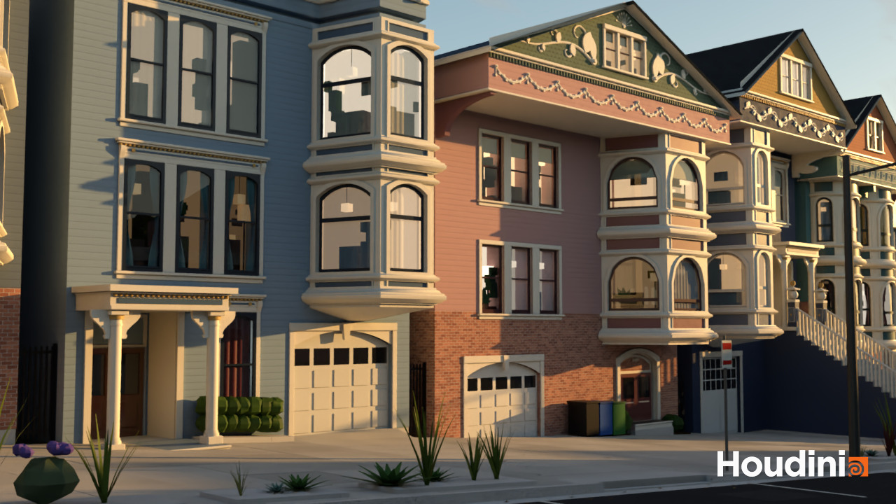
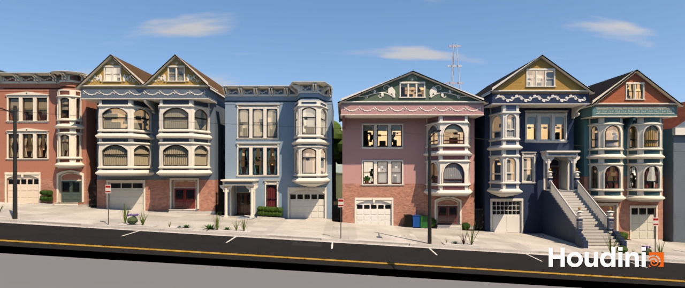
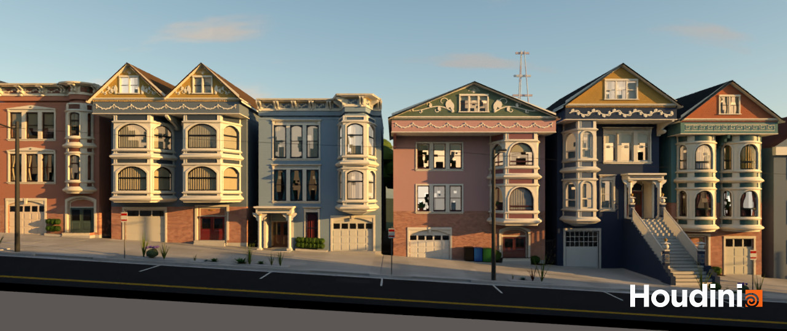
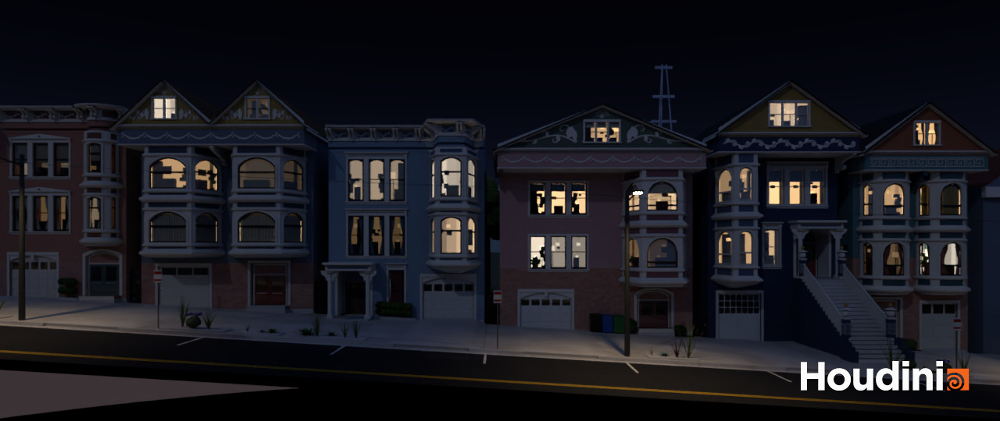
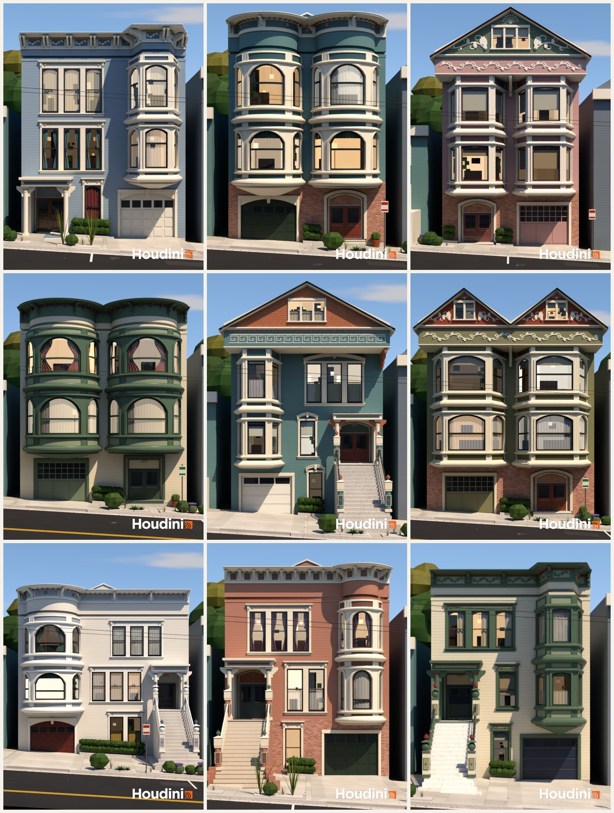

# Painted Ladies: a procedural San Francisco street

A Houdini digital asset that generates a three-storey San Francisco Victorian from a seed, and a street system
that lays any number of them down a hill with sidewalks, driveways, trees, bins, lamps and Muni wires.
Everything, from the cornice brackets to which rooms have their lights on, is generated. Nothing is hand-placed.

**Write-up:** [felicityyick.com/project/sf-victorian-street](https://felicityyick.com/project/sf-victorian-street) ·
**Agent tooling:** [houdini-mcp](https://github.com/feliyick/houdini-mcp), the MCP server I built to iterate on this scene with an AI agent.

| Sunny | Golden hour | Night |
|---|---|---|
|  |  |  |

*Nine houses, nine seeds. Same tool, no hand edits.*

## How it's built
- **The tool.** One HDA, `victorian_house`, with 96 artist-facing parameters across nine tabs (House, Size, Bays,
  Windows, Entry & Stairs, Roof, Paint, Interior, Ornament). Every menu defaults to *Auto*; anything an artist sets
  overrides just that decision.
- **Layout from a rule table.** Each row is a valid house (bays per column, door floor), so features never
  contradict each other: no bay hovering over a garage.
- **Stages as VEX wrangles.** Openings, roof and cornice, ornament, porch, window dressing and paint each read the
  previous stage's attributes and write their own. Anything that has to line up is built from the same numbers.
- **Ornament from slots.** The roof and porch leave slot points behind; the ornament stage decides what to grow there.
- **Windows that look lived in.** A shallow room behind every window, curtains fitted to curved bay glass, one room
  ID driving whether and how a room is lit.
- **Paint and materials.** Paint roles from build groups, twelve palettes, procedural world-space MaterialX (no UVs)
  generated by a Python script.
- **The street.** Reads the houses' own geometry: a 6% hill, a sidewalk that widens to fit the deepest stoop,
  driveways to found curb cuts, props that slide clear of each other, backdrop city and Sutro Tower.
- **Lighting.** Karma CPU through Solaris, four looks on one switch (sunny, golden, dusk, night).

## Opening it
- Houdini **20.5** or newer. The `.hipnc` / `.hdanc` files were made with a **non-commercial (Apprentice)** licence,
  so they open in Apprentice, Education or Indie-in-non-commercial mode, not in a commercial session.
- Open `SanFranciscoHouse_v4_hda.hipnc` from this folder. The HDA loads from `otls/`, VEX includes from
  `vex/include/`, materials from `materials/house_materials_v16.mtlx`, all relative to the scene.
- The hero house is `/obj/sf_house_geometry/victorian_house`; the street controls are on `STREET_CONTROLS`.
  Lighting looks are on `/stage/sfh_look`.
- Note: the HDA's wrangles `#include` `vex/include/facade_lib.h`, so the asset needs this folder next to it. It isn't
  self-contained yet.

## Folder map
| Path | |
|---|---|
| `SanFranciscoHouse_v4_hda.hipnc` | the scene |
| `otls/sfh_victorian_house.hdanc` | the house HDA |
| `*.vfl` | VEX source for every wrangle (HDA stages + street) |
| `vex/include/facade_lib.h`, `street_lib.h` | shared VEX: chamfered boxes, brackets, plan helpers, ground height, street primitives |
| `materials/build_materials.py` | generates the MaterialX library (`house_materials_vN.mtlx`) |
| `lights_lop.py`, `street_lights_lop.py` | Python LOPs: room/lamp emission per look, street-lamp lights |
| `check_errors.py` | re-cooks the asset and stage and lists every node with an error |
| `capture_portfolio.py`, `exr2web.py`, `make_contact_sheet.py` | unattended Karma renders and web conversion |
| `houdini_mcp_config.json` | this project's settings for [houdini-mcp](https://github.com/feliyick/houdini-mcp) |
| `CLAUDE.md` | the agent's context file: scene map, conventions, and every VEX pitfall we hit |
| `render/portfolio/web/` | the renders above |

Some utility scripts contain absolute paths from my machine; they're a record of how the project was built,
not something to re-run elsewhere as-is.

## How it was built
I built about half of the house HDA by hand, getting back into Houdini after a break. Early on I used Claude to
answer questions and guide me (VEX, how to structure a stage, debugging); the rules, the network and the design
calls were mine. Once the base was in place I built [houdini-mcp](https://github.com/feliyick/houdini-mcp), my own
MCP server for the live Houdini session, and used it to iterate faster: the agent reads the network, makes small
backed-up edits, and checks its work with cooks, viewport captures and Karma previews, while I make the calls.
`CLAUDE.md` is the context file the agent works from. The write-up covers the workflow in more detail.

## Licence
Code (VEX, Python): MIT, see `LICENSE`. Renders: © Felicity Yick. Houdini files are non-commercial, per the
SideFX Apprentice licence.
